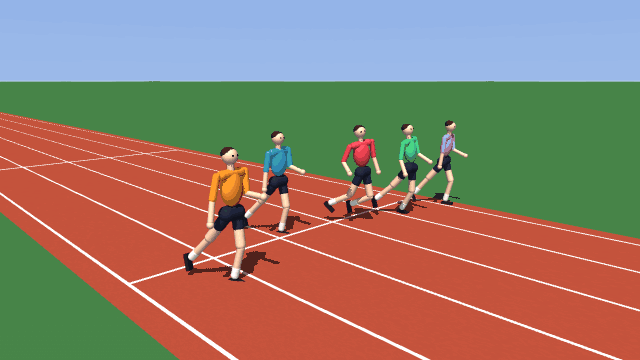
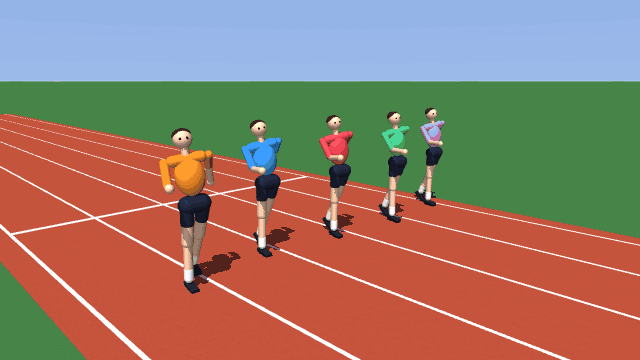
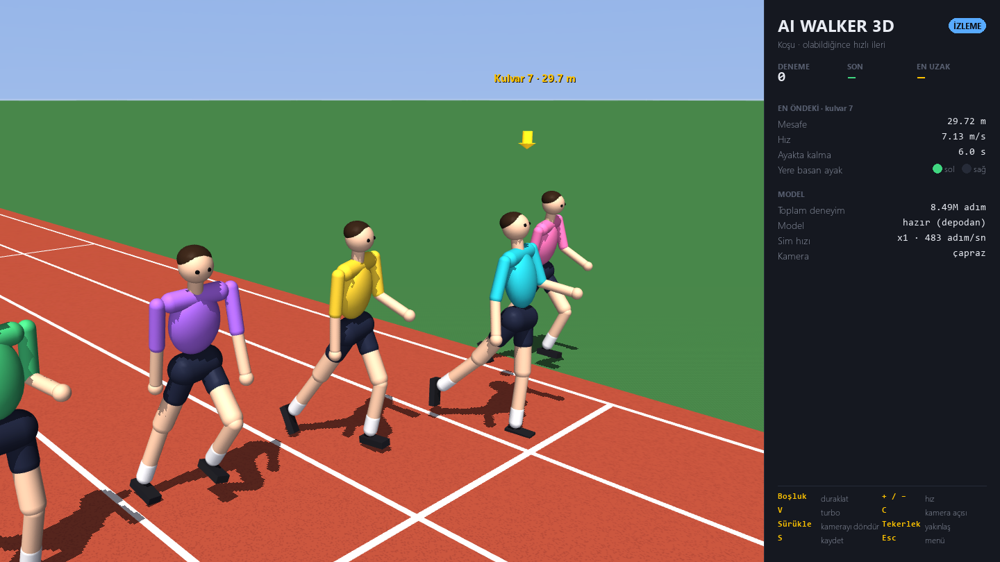
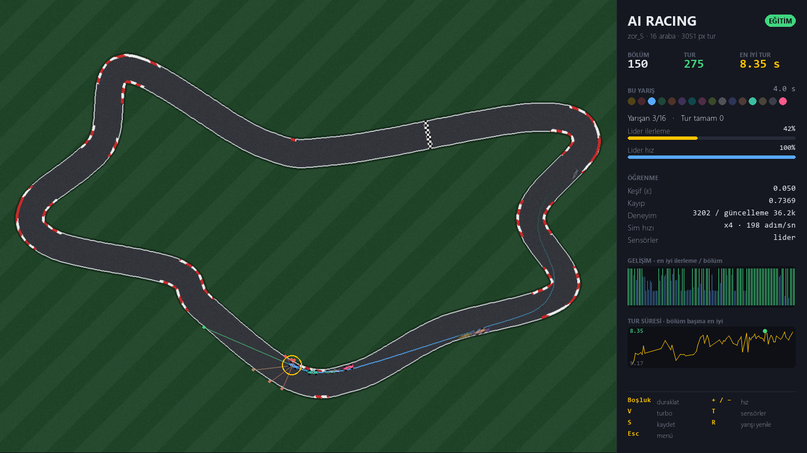

<div align="center">

# AI Simulations

**Two agents that start out knowing nothing and learn purely by trial and error.**<br>
A 3D humanoid that teaches itself to walk and run, and a fleet of race cars that learn to lap any track.

[](https://github.com/yahyio/ai-simulations/actions/workflows/ci.yml)


[](LICENSE)

**English** · [Türkçe](README.tr.md)



</div>

| | Simulation | Learns | Algorithm |
|---|---|---|---|
| 🏃 | **AI Walker 3D** | a 21-joint humanoid learns to stand, walk and run | PPO · MuJoCo |
| 🏎️ | **AI Racing** | 16 cars learn to drive laps on hand-drawn or procedurally generated tracks | Dueling Double DQN |

Both come with a real-time pygame interface — watch the agents fail, improve and eventually master the task,
with live learning curves, a turbo mode and a free camera — plus a headless mode for fast training.

## Quick start

Requires **Python 3.10+**. Works on Windows, Linux and macOS; no GPU needed.

```bash
git clone https://github.com/yahyio/ai-simulations.git
cd ai-simulations
python -m venv .venv
.venv\Scripts\activate          # Linux/macOS: source .venv/bin/activate
pip install -r requirements.txt
python main.py                  # launcher: pick a simulation
```

Each simulation can also be started directly:

```bash
python -m walker                # AI Walker 3D
python -m racing                # AI Racing
```

> [!TIP]
> Pretrained walking and running policies ship with the repository, so **Yürüyüşü izle** (*watch walking*) and
> **Koşuyu izle** (*watch running*) work right after cloning. Choose **Yürümeyi öğren** (*learn to walk*) to see a
> brand-new humanoid start from zero. The in-app interface is in Turkish; everything else is documented here.

---

## 🏃 AI Walker 3D

A physically simulated humanoid (63 kg, 1.75 m) is dropped onto an athletics track. It has no idea what legs are
for: at first it flails and collapses within a second. Its only feedback is a single number per step — the reward —
and from that alone it discovers balance, stepping, arm swing and finally a steady walk or a sprint.
48 humanoids train in parallel; in the window you see 8 of them racing side by side, one per lane.

<p align="center">


</p>

| Steps | Walking (target 1.4 m/s) | Running (as fast as possible) |
|---|---|---|
| 0.5 M | flails and falls within 2 s | flails and falls within 2 s |
| 2 M | first wobbly steps, 7 m before falling | stumbles forward: 22 m at 2.1 m/s |
| 4 M | walks the full 20 s in 93 % of the attempts, 1.44 m/s | 57 m at 3.8 m/s |
| 6 M | steady alternating gait with arm swing, 97 % without a fall | 75 m at 5.0 m/s |
| 8.5 M | | real running stride with flight phases: 101 m at 5.6 m/s |

<sub>Averages over the ~200 training attempts around each point (one attempt lasts at most 20 s), default settings
(`python -m walker --headless`) on a 6-core desktop CPU at 4 000–6 000 steps/s: a steady walk appears after about
15 minutes. Training attempts include exploration noise; without it, the bundled policies finished all 48 test runs
without a fall — walking at 1.31 m/s, running at 6.06 m/s (22 km/h).</sub>

### The body

- **21 actuated joints** — abdomen (3), hips (3 each), knees, ankles (2 each), shoulders (2 each), elbows.
  Each joint is a PD position servo with human-like torque limits (hip/knee 250 N·m, ankle 150 N·m, shoulder 60 N·m).
- Legs collide with each other and the ground; realistic mass distribution (MuJoCo, 250 Hz physics).
- **Actions** (50 Hz): a target angle for every joint.
- **Observations** (80 values): pelvis height, gravity direction and velocities in the body frame, heading and lane
  offset, joint angles and velocities, the previous action, foot contacts and the gait clock.

### What it is rewarded for

The reward says *how well* it is doing, never *how* to do it. There are no motion-capture clips or reference gaits.
The only hint is a metronome: foot contacts that follow its rhythm (a 1 s cycle for walking, 0.7 s for running)
earn a little extra.

| Term | Why it exists |
|---|---|
| Forward speed, **gated by an upright torso** | the goal itself; without the gate it "discovers" diving forward |
| Staying alive (+2 per step), falling (−10) | falls end the episode |
| Foot contacts in time with the gait clock | without it the agent hopped forward on both feet like a kangaroo |
| Upright posture, heading, lane drift, sideways speed | walk straight down the lane, not sideways or twisted |
| Alternating steps with enough air time | no shuffling, no hopping on one leg |
| Foot clearance, stance width, sliding feet | no high kicks, no tightrope walking, no skating |
| Hip/abdomen/shoulder deviation, action rate, torque | natural, energy-efficient motion instead of jitter |

Walking rewards speed up to 1.4 m/s and penalizes going faster; running rewards speed up to 8 m/s.

### Controls

| Key | Action |
|---|---|
| `Space` | pause / resume |
| `+` / `-` | simulation speed (×1 … ×8) |
| `V` | turbo — train as fast as the CPU allows |
| `C` | camera preset: 3/4 · side · behind · front · top |
| mouse drag / wheel | orbit / zoom |
| `S` | save the model |
| `Esc` | save and return to the menu |

### Headless training

```bash
python -m walker --headless --task yurume --steps 10000000   # walking
python -m walker --headless --task kosu --steps 20000000     # running
```

Models are written to `data/walker/<task>/` (latest and best), learning logs to `logs/walker_<task>.csv`.
Training resumes from the saved model unless `--fresh` is given.

<details>
<summary><b>Implementation details</b></summary>

- **PPO** with clipped surrogate objective, GAE (γ = 0.99, λ = 0.95), 5 epochs × 4 minibatches per update,
  a diagonal Gaussian policy (ELU MLP 256-256) with state-independent log-σ, observation normalization,
  return scaling and value bootstrapping at time limits (`terminated` vs `truncated`).
- **Vectorized environments** across processes (`walker/vecenv.py`): 48 humanoids are split over the physical cores
  while the main process runs the network; the same code runs single-process for tests and the viewer.
- **Rendering** uses MuJoCo's offscreen OpenGL renderer; frames are blitted into pygame, labels are projected
  from 3D world coordinates.
- Checkpoints carry a header (version, observation/action size, network shape) so incompatible models are
  detected with a clear message instead of a crash.

</details>

---

## 🏎️ AI Racing

<div align="center">

</div>

Sixteen cars share one neural network and learn to drive with **Dueling Double DQN**. On the default track the first
lap usually comes around episode 5; a few episodes later nearly every car finishes.

- **Any image is a track.** Dark pixels are asphalt, a red line is start/finish. No checkpoints to place by hand:
  a geodesic distance field (Dijkstra from the start line) gives progress, lap and wrong-way detection for free.
- **Procedural tracks** with selectable difficulty — Easy, Medium, Hard or Random. Tracks never self-intersect and
  are validated before use; the same seed always gives the same track.
- **Vectorized physics** in NumPy: acceleration, braking, friction, drifting at speed and 7 ray-cast distance
  sensors for every car in a single step, with a fixed time step so simulation speed never changes the results.
- **Agent:** dueling architecture, Double-DQN targets, 3-step returns, soft target updates, experience replay
  and a spread of exploration rates across the cars (car #1 is almost greedy and shows what has been learned).

| Key | Action |
|---|---|
| `Space` | pause / resume |
| `+` / `-` | simulation speed (×1 … ×16) |
| `V` | turbo |
| `T` | sensor rays: off · leader · all |
| `S` | save |
| `R` | restart the race |
| `Esc` | save and return to the menu |

```bash
python -m racing --headless --episodes 300          # train without a window
python -m racing --new-track zor --seed 42          # generate a hard track (kolay/orta/zor/rastgele)
```

**Draw your own track:** white background, black closed loop, and a red (255, 0, 0) line across the track for
start/finish. Point `track.file` in `config.yaml` to it (cars start to the right of a vertical line; set
`track.reverse: true` to flip). All settings are also editable in the in-app **Settings** screen;
see [`config.example.yaml`](config.example.yaml).

---

## Project layout

```
main.py                 launcher for both simulations
walker/                 AI Walker 3D
  model.py              humanoid and stadium, generated as MuJoCo MJCF
  env.py                reward, observations, falls, step tracking
  vecenv.py             multi-process vectorized environments
  ppo.py                PPO, running normalizers, checkpoints
  trainer.py            training / watching loop (UI independent)
  render.py             3D stadium renderer and camera
  app.py, hud.py        window, menu and side panel
racing/                 AI Racing
  track.py              track analysis: drivable mask, progress and direction fields
  trackgen.py           procedural track generator
  env.py                vectorized car physics and sensors
  agent.py              Dueling Double DQN with n-step replay
  trainer.py, storage.py, config.py
  app.py, render.py, hud.py, picker.py, ui.py
common/                 shared pygame theme and widgets
models/walker/          pretrained walking and running policies
tests/                  pytest suite
```

## Development

```bash
pip install -r requirements-dev.txt
python -m pytest --cov        # unit, integration and headless end-to-end tests
ruff check .                  # lint
```

The CI runs the linter and the test suite on Linux and Windows for every push.

## License

[MIT](LICENSE) © MrYaho
