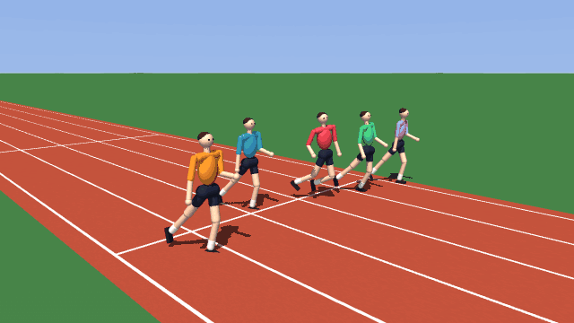
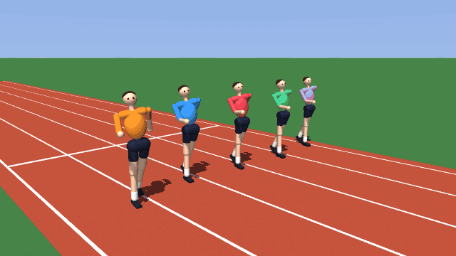
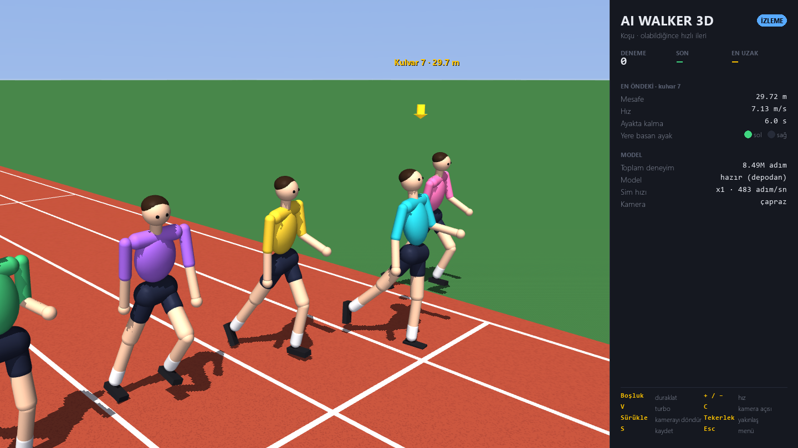
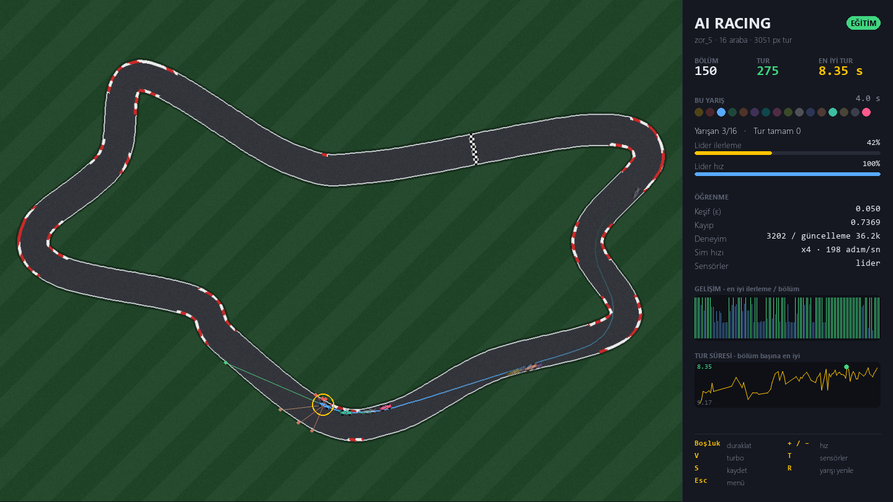

<div align="center">

# AI Simülasyonları

**Hiçbir şey bilmeden başlayıp yalnızca deneme yanılmayla öğrenen iki yapay zekâ.**<br>
Kendi kendine yürümeyi ve koşmayı öğrenen 3B bir hümanoid ve her pistte tur atmayı öğrenen yarış arabaları.

[](https://github.com/yahyio/ai-simulations/actions/workflows/ci.yml)


[](LICENSE)

[English](README.md) · **Türkçe**



</div>

| | Simülasyon | Ne öğreniyor | Algoritma |
|---|---|---|---|
| 🏃 | **AI Walker 3D** | 21 eklemli bir hümanoid ayakta durmayı, yürümeyi ve koşmayı öğrenir | PPO · MuJoCo |
| 🏎️ | **AI Racing** | 16 araba, elle çizilmiş ya da rastgele üretilmiş pistlerde tur atmayı öğrenir | Dueling Double DQN |

İkisinin de gerçek zamanlı bir pygame arayüzü var: ajanların önce başarısız olup sonra ustalaştığını canlı öğrenme
grafikleri, turbo modu ve serbest kamerayla izleyebilirsiniz. Hızlı eğitim için pencere olmadan da çalışırlar.

## Hızlı başlangıç

**Python 3.10+** gerekir. Windows, Linux ve macOS'ta çalışır; ekran kartı gerekmez.

```bash
git clone https://github.com/yahyio/ai-simulations.git
cd ai-simulations
python -m venv .venv
.venv\Scripts\activate          # Linux/macOS: source .venv/bin/activate
pip install -r requirements.txt
python main.py                  # başlatıcı: simülasyonu seçin
```

Simülasyonlar doğrudan da başlatılabilir:

```bash
python -m walker                # AI Walker 3D
python -m racing                # AI Racing
```

> [!TIP]
> Eğitilmiş yürüme ve koşu modelleri depoyla birlikte gelir: **Yürüyüşü izle** ve **Koşuyu izle** klonladıktan hemen
> sonra çalışır. Sıfırdan öğrenen yeni bir hümanoidi görmek için **Yürümeyi öğren**'i seçin.

---

## 🏃 AI Walker 3D

Fiziksel olarak simüle edilen bir hümanoid (63 kg, 1.75 m) atletizm pistine bırakılır. Bacaklarının ne işe yaradığını
bilmez: ilk denemelerde çırpınır ve bir saniye içinde yere yığılır. Tek geri bildirimi her adımda aldığı bir sayıdır —
ödül. Yalnızca bununla dengeyi, adım atmayı, kol sallamayı ve sonunda düzgün bir yürüyüşü ya da koşuyu keşfeder.
48 hümanoid paralel olarak eğitilir; pencerede 8'i kulvarlarda yan yana yarışır.

<p align="center">


</p>

| Adım | Yürüme (hedef 1.4 m/s) | Koşu (olabildiğince hızlı) |
|---|---|---|
| 0.5 M | çırpınıyor, 2 saniye içinde düşüyor | çırpınıyor, 2 saniye içinde düşüyor |
| 2 M | ilk sendeleyen adımlar, düşmeden önce 7 m | öne doğru sendeliyor: 2.1 m/s ile 22 m |
| 4 M | denemelerin %93'ünde 20 saniyeyi tamamlıyor, 1.44 m/s | 3.8 m/s ile 57 m |
| 6 M | kol sallayan, sağ-sol sıralı düzgün yürüyüş; %97 düşmeden | 5.0 m/s ile 75 m |
| 8.5 M | | uçuş anları olan gerçek koşu adımı: 5.6 m/s ile 101 m |

<sub>Her noktanın çevresindeki ~200 eğitim denemesinin ortalaması (bir deneme en fazla 20 saniye), varsayılan ayarlar
(`python -m walker --headless`), 6 çekirdekli masaüstü işlemcide saniyede 4 000–6 000 adım: düzgün yürüyüş yaklaşık
15 dakikada ortaya çıkıyor. Eğitim denemelerinde keşif gürültüsü vardır; gürültü olmadan depodaki modeller 48 test
koşusunun hepsini düşmeden bitirdi — yürüme 1.31 m/s, koşu 6.06 m/s (22 km/sa).</sub>

### Beden

- **21 motorlu eklem**: bel (3), kalçalar (3'er), dizler, ayak bilekleri (2'şer), omuzlar (2'şer), dirsekler.
  Her eklem insana yakın tork sınırları olan bir PD konum servosudur (kalça/diz 250 N·m, ayak bileği 150 N·m, omuz 60 N·m).
- Bacaklar birbirine ve zemine çarpar; gerçekçi kütle dağılımı (MuJoCo, 250 Hz fizik).
- **Eylemler** (50 Hz): her eklem için bir hedef açı.
- **Gözlem** (80 değer): leğen yüksekliği, gövdeye göre yerçekimi yönü ve hızlar, yön ve kulvardan sapma, eklem açıları
  ve hızları, son eylem, ayak temasları ve adım saati.

### Neye göre ödüllendiriliyor?

Ödül yalnızca *ne kadar iyi* gittiğini söyler, *nasıl* yapılacağını asla. Hareket yakalama kaydı ya da örnek yürüyüş yoktur.
Tek ipucu bir metronomdur: ayak temasları bu ritme (yürümede 1 s, koşuda 0.7 s'lik tur) uyduğunda ödül biraz artar.

| Terim | Neden var? |
|---|---|
| İleri hız, **gövde dikken** | asıl amaç; bu koşul olmadan ajan öne doğru "balıklama" atlamayı keşfediyor |
| Ayakta kalma (adım başına +2), düşme (−10) | düşünce deneme biter |
| Ayak temaslarının adım saatine uyması | saat olmadan ajan iki ayakla birlikte zıplayarak (kanguru gibi) ilerliyordu |
| Sırayla atılan, yeterince havada kalan adımlar | ayak sürümeyi ve tek ayakla sekmeyi önler |
| Dik duruş, yön, kulvardan sapma, yana kayma | kulvarda düz, dik yürüsün; yan yan ya da dönerek değil |
| Ayak yüksekliği, ayaklar arası en az mesafe, kayan ayak | yüksek tekme, ip üstünde yürür gibi çapraz adım ya da buz üstünde kayma yok |
| Bel/kalça/omuz sapması, eylem değişimi, tork | titreme yerine doğal ve az enerjili hareket |

Yürümede 1.4 m/s'ye kadar hız ödüllendirilir, üstü cezalıdır; koşuda 8 m/s'ye kadar her hız ödüllendirilir.

### Tuşlar

| Tuş | İşlev |
|---|---|
| `Boşluk` | duraklat / devam |
| `+` / `-` | simülasyon hızı (×1 … ×8) |
| `V` | turbo — işlemcinin izin verdiği en yüksek hız |
| `C` | kamera: çapraz · yan · arka · ön · kuşbakışı |
| fareyle sürükle / tekerlek | kamerayı döndür / yakınlaş |
| `S` | modeli kaydet |
| `Esc` | kaydet ve menüye dön |

### Pencere olmadan eğitim

```bash
python -m walker --headless --task yurume --steps 10000000   # yürüme
python -m walker --headless --task kosu --steps 20000000     # koşu
```

Modeller `data/walker/<görev>/` klasörüne (son ve en iyi), öğrenme günlükleri `logs/walker_<görev>.csv` dosyasına yazılır.
`--fresh` verilmedikçe eğitim kayıtlı modelden devam eder.

<details>
<summary><b>Teknik ayrıntılar</b></summary>

- **PPO**: kırpılmış amaç fonksiyonu, GAE (γ = 0.99, λ = 0.95), güncelleme başına 5 tur × 4 mini yığın, durumdan bağımsız
  log-σ'lı çapraz Gauss politika (ELU MLP 256-256), gözlem normalizasyonu, getiri ölçekleme ve süre sınırında değer tahmini
  (`terminated` ile `truncated` ayrımı).
- **Paralel ortamlar** (`walker/vecenv.py`): 48 hümanoid fiziksel çekirdeklere dağıtılır, ana süreç sinir ağını çalıştırır;
  testler ve izleme modu aynı kodu tek süreçte kullanır.
- **Görüntü**: MuJoCo'nun ekran dışı OpenGL çizicisi; kareler pygame'e aktarılır, etiketler 3B dünya koordinatlarından
  ekrana izdüşürülür.
- Model dosyaları bir başlık taşır (sürüm, gözlem/eylem boyutu, ağ yapısı); uyumsuz bir model çökme yerine açık bir
  mesajla bildirilir.

</details>

---

## 🏎️ AI Racing

<div align="center">

</div>

On altı araba tek bir sinir ağını paylaşır ve **Dueling Double DQN** ile sürmeyi öğrenir. Varsayılan pistte ilk tur
genellikle 5. bölüm civarında gelir; birkaç bölüm sonra arabaların neredeyse tamamı turu bitirir.

- **Her görsel bir pisttir.** Koyu pikseller asfalt, kırmızı çizgi başlangıç/bitiştir. Elle checkpoint yerleştirmeye gerek
  yok: başlangıç çizgisinden hesaplanan jeodezik mesafe alanı (Dijkstra) ilerlemeyi, turu ve ters yönü kendiliğinden verir.
- **Rastgele pistler**, seçilebilir zorlukla: Kolay, Orta, Zor ya da Rastgele. Pistler kendini kesmez ve kullanılmadan
  önce doğrulanır; aynı tohum her zaman aynı pisti verir.
- **Vektörize fizik** (NumPy): ivme, fren, sürtünme, yüksek hızda savrulma ve 7 mesafe sensörü tüm arabalar için tek adımda
  hesaplanır. Zaman adımı sabittir; simülasyon hızı sonuçları değiştirmez.
- **Ajan:** dueling mimari, Double DQN hedefi, 3 adımlı getiri, yumuşak hedef ağ, deneyim tekrarı ve arabalara yayılmış
  farklı keşif oranları (1 numaralı araba neredeyse açgözlüdür ve öğrenileni gösterir).

| Tuş | İşlev |
|---|---|
| `Boşluk` | duraklat / devam |
| `+` / `-` | simülasyon hızı (×1 … ×16) |
| `V` | turbo |
| `T` | sensör ışınları: kapalı · lider · tümü |
| `S` | kaydet |
| `R` | yarışı yeniden başlat |
| `Esc` | kaydet ve menüye dön |

```bash
python -m racing --headless --episodes 300          # pencere olmadan eğit
python -m racing --new-track zor --seed 42          # zor bir pist üret (kolay/orta/zor/rastgele)
```

**Kendi pistinizi çizin:** beyaz zemin, siyah kapalı bir döngü ve pisti enlemesine kesen kırmızı (255, 0, 0) bir başlangıç
çizgisi. `config.yaml` içindeki `track.file` değerini bu dosyaya yönlendirin (arabalar dikey çizginin sağına doğru başlar;
ters yön için `track.reverse: true`). Tüm ayarlar uygulamadaki **Ayarlar** ekranından da değiştirilebilir;
bkz. [`config.example.yaml`](config.example.yaml).

---

## Proje yapısı

```
main.py                 iki simülasyon için başlatıcı
walker/                 AI Walker 3D
  model.py              hümanoid ve stadyum (MuJoCo MJCF olarak üretilir)
  env.py                ödül, gözlem, düşme ve adım takibi
  vecenv.py             çok süreçli paralel ortamlar
  ppo.py                PPO, normalizasyon, model dosyaları
  trainer.py            eğitim / izleme döngüsü (arayüzden bağımsız)
  render.py             3B stadyum çizimi ve kamera
  app.py, hud.py        pencere, menü ve yan panel
racing/                 AI Racing
  track.py              pist analizi: sürülebilir alan, ilerleme ve yön alanları
  trackgen.py           rastgele pist üretici
  env.py                vektörize araba fiziği ve sensörler
  agent.py              n adımlı deneyim tekrarlı Dueling Double DQN
  trainer.py, storage.py, config.py
  app.py, render.py, hud.py, picker.py, ui.py
common/                 ortak pygame teması ve bileşenleri
models/walker/          eğitilmiş yürüme ve koşu modelleri
tests/                  pytest testleri
```

## Geliştirme

```bash
pip install -r requirements-dev.txt
python -m pytest --cov        # birim, entegrasyon ve penceresiz uçtan uca testler
ruff check .                  # lint
```

CI her gönderimde lint ve testleri Linux ve Windows üzerinde çalıştırır.

## Lisans

[MIT](LICENSE) © MrYaho
